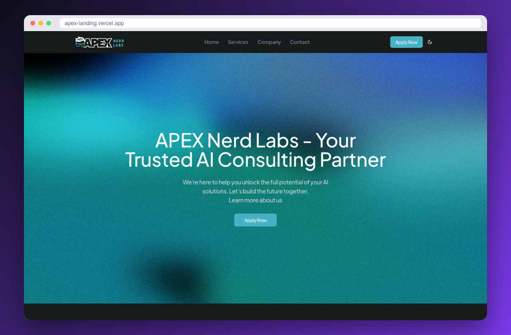

# Apex Nerd Labs: AI Service Landing Page

A landing page for a client's AI service. I built both the design and the functionality: animated sections, light and dark themes, and a working contact form that sends branded HTML emails.

**[Live demo](https://apex-landing.vercel.app)**



    

## Features

- Custom design, fully responsive from mobile to wide desktop
- Scroll and entrance animations with Framer Motion
- Light and dark mode via `next-themes`
- Contact form that sends HTML email templates built with React Email and delivered by Nodemailer (SMTP)
- Accessible UI components from shadcn/ui (Radix)

## Getting started

```bash
git clone https://github.com/srg201/apex-landing.git
cd apex-landing
npm install
cp .env.example .env   # SMTP credentials for the contact form
npm run dev
```

## Author

**Siarhei Beliakou** · Full Stack Developer (React, Next.js, NestJS)
[GitHub](https://github.com/srg201) · [LinkedIn](https://linkedin.com/in/sergey-belyakov-1b7641349) · belyakov329@gmail.com

Open to freelance and full-time work.
